<h1 align="center">OpenBand</h1>

<p align="center"><b>I built my own WHOOP.</b></p>

<p align="center">
  An open-source, screenless wearable health tracker built from scratch: custom PCB, custom
  firmware, custom enclosure, custom iOS app. It reads heart rate, blood oxygen, and steps off
  your wrist and streams them to your phone over Bluetooth.
</p>

<p align="center">
  
  
  
  
</p>

---

## Why I built this

I wanted to know whether I could build a real consumer wearable end to end, by myself, rather
than wiring a dev board to a breakout sensor and calling it a project. That means every layer:
schematic capture, a two-layer board with an RF section that actually works, hand assembly,
bare-metal bring-up, an RTOS, sensor drivers written against datasheets, the signal processing
that turns raw photodiode counts into a heart rate, a Bluetooth GATT server, a printed
enclosure, and a native phone app to display it all.

WHOOP is the reference point because it has the same architecture as what I wanted to build: no
screen, no buttons, worn continuously on a strap, with all the intelligence in the sensors and
all the interface on your phone. That constraint is what makes it interesting. There is no
display to hide behind, so the device either produces trustworthy numbers or it does not.

It works. Heart rate, SpO2, steps, and battery all read correctly on hardware I designed and
soldered, and stream live to an app I wrote. Everything needed to build one is in this repo:
schematics, board layout, fabrication outputs, firmware, enclosure models, the full bill of
materials, and the iOS app.

> Not affiliated with WHOOP, Inc. The name is used only as shorthand for the category of device.

### What it tracks

| Metric | Source | How |
|--------|--------|-----|
| **Heart rate** | MAX30102 PPG | Autocorrelation on the IR waveform (40–200 bpm band), quality-gated by perfusion index |
| **Blood oxygen (SpO2)** | MAX30102 PPG | Red/IR AC-to-DC ratio-of-ratios |
| **Steps** | BMI270 IMU | Onboard hardware step counter, with a software pedometer fallback |
| **Battery** | ADC divider | 100 kΩ / 220 kΩ divider off the LiPo rail |

All four stream to the phone over BLE every 2 seconds.

---

## The device

OpenBand is worn on the wrist with a standard strap. The electronics are a single ~38 mm
circular board that drops into a 3D-printed enclosure; the strap threads through slots on either
side, and four M1.6 screws retain the board from below. A cutout in the bottom of the case
exposes the optical sensor so it sits directly against the skin, which is the whole game for
photoplethysmography: the sensor has to be in firm, consistent contact with the wrist or the
pulse waveform disappears into noise.

<p align="center">
  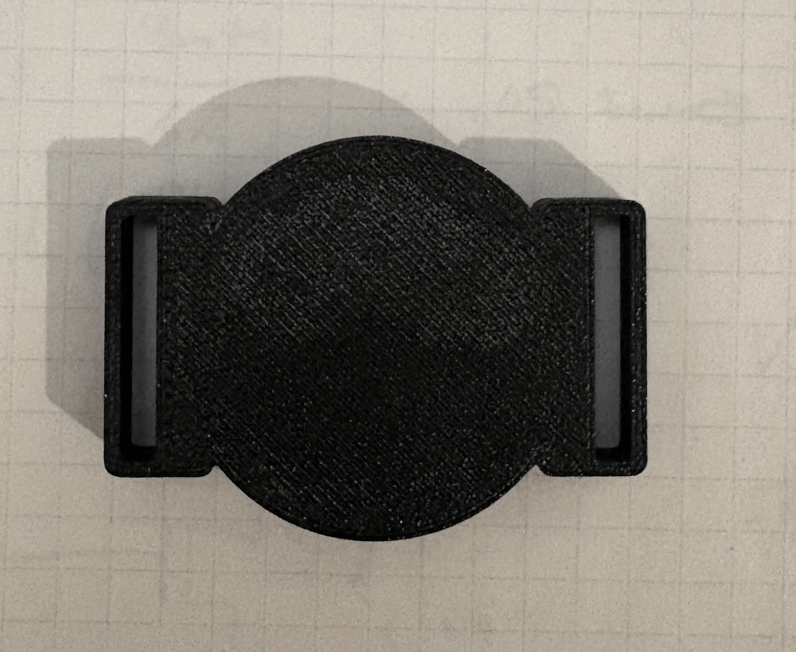
  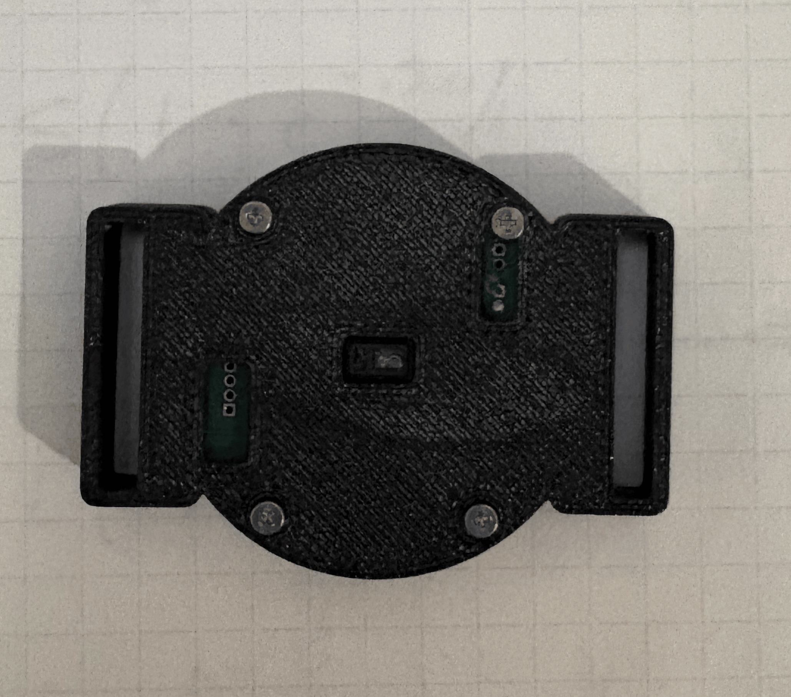
</p>

The top shell holds the board in a circular pocket with a strap slot on each side. The bottom
retains it with four screws and exposes the MAX30102 window in the center.

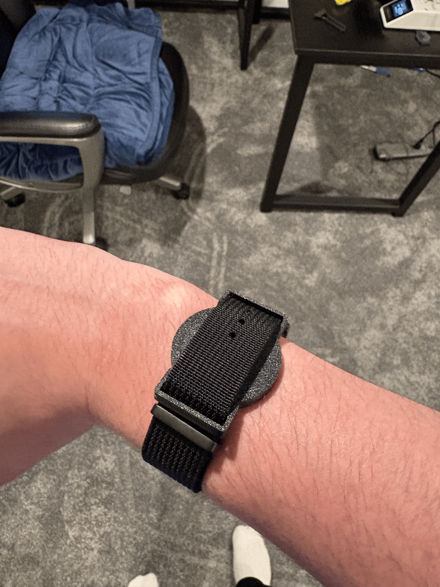

The enclosure is OpenSCAD, in [`case/`](case), and went through two revisions. V1 taught me
most of what was wrong with it: the interior needed to be a true circle because the strap mounts
were intruding on the board pocket, the sensor window was slightly too small, the screw holes
were undersized for M1.6 threads, the programming-header opening did not line up with the pins,
and the outer wall of the strap slot was too thin to survive being worn. V2 fixed all of it.

---

## PCB design

A two-layer circular PCB, roughly 38 mm across, with a cutout at the bottom edge for strap
clearance and four mounting holes for the enclosure screws.

### 3D renders

**Front side.** The CYBLE-416045-02 BLE module dominates the center of the board with its MIFA
antenna exposed along the top edge, deliberately kept clear of copper pours for RF performance.
The BMI270 IMU sits bottom-left, the 32.768 kHz RTC crystal is top-left, and the LiPo charger IC
(U4_CHAR1), 1.8 V LDO (U5_1P8), and supporting passives are packed along the right edge. The SWD
programming header (JPROG1) and the battery/charger pads are on the left and bottom-right.

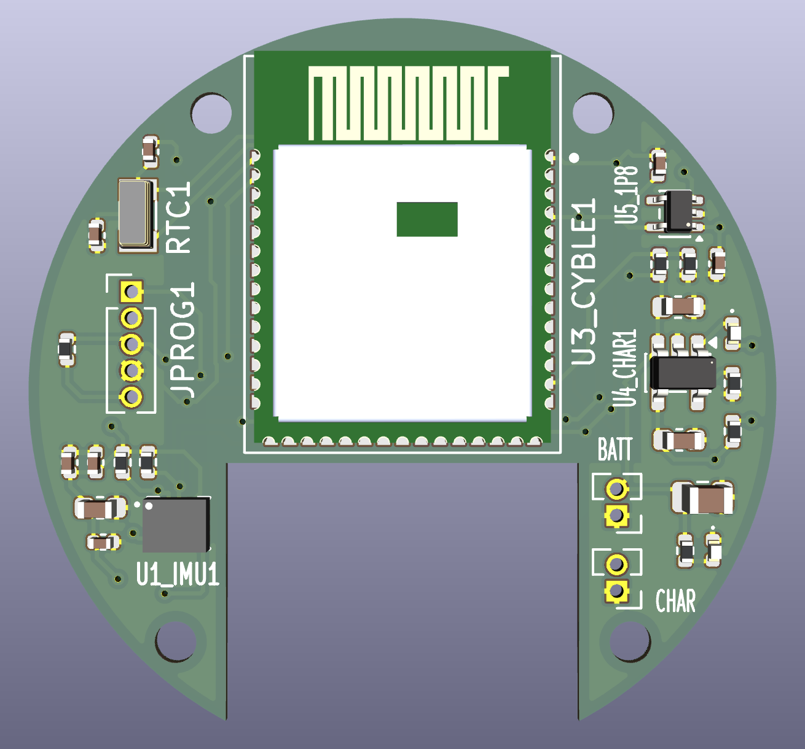

**Back side.** The MAX30102 optical heart rate and SpO2 sensor (U2_MAX1) is mounted on the back
of the board, facing down toward the skin when worn. Putting it on this side keeps the optical
window unobstructed and in direct contact with the wrist. Its decoupling capacitors are grouped
tightly around it to keep switching noise off the LED drive lines.

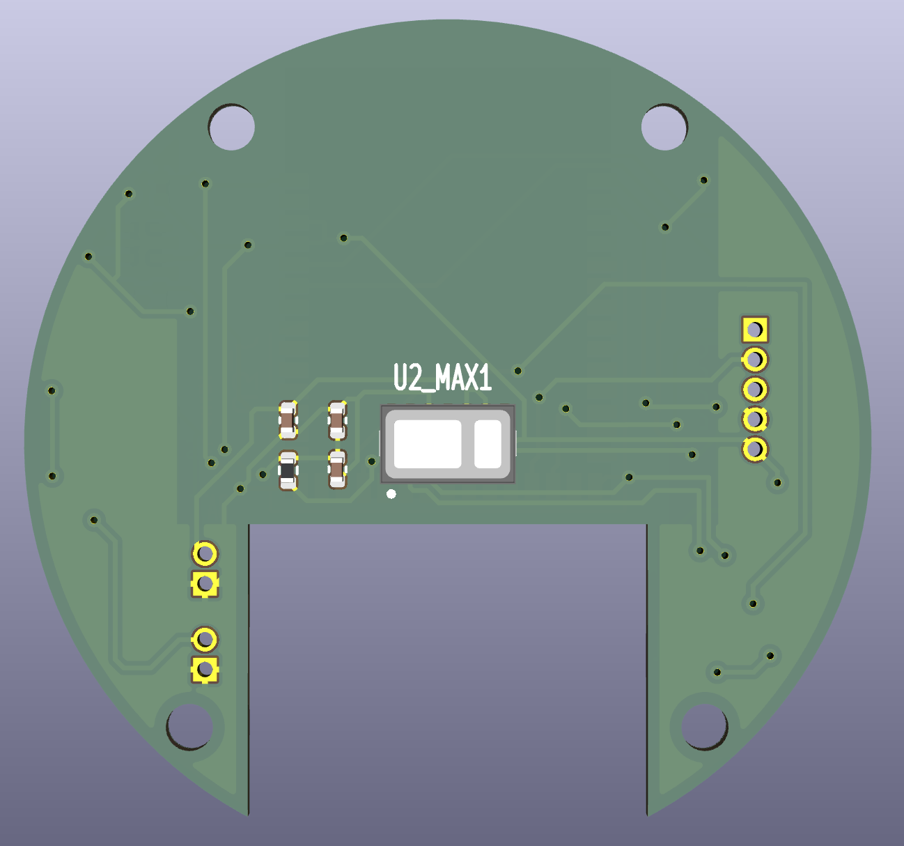

### Routing

**Front copper (F.Cu).** Red traces carry the I2C bus (SDA/SCL) from the CYBLE module out to the
BMI270 and down through vias to the MAX30102 on the back. The RTC lines route separately to
avoid crosstalk. Power distribution fans out from the LDO and charger on the right side.

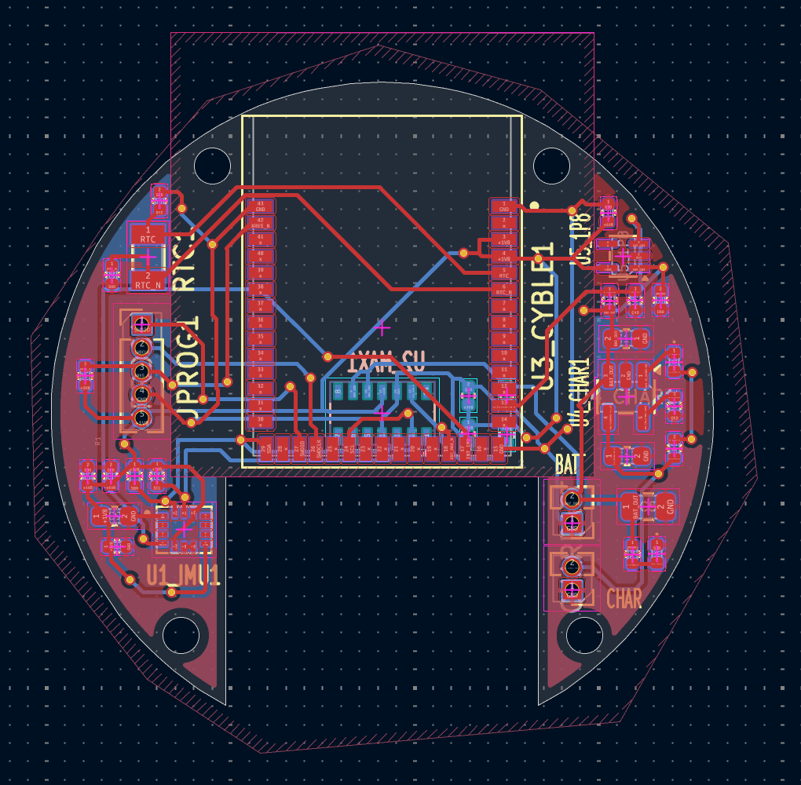

**Back copper (B.Cu).** The back layer is kept deliberately sparse, primarily the I2C and power
connections to the MAX30102 plus the battery and charger fanout. The copper-free keepout under
the CYBLE module's antenna extends through both layers.

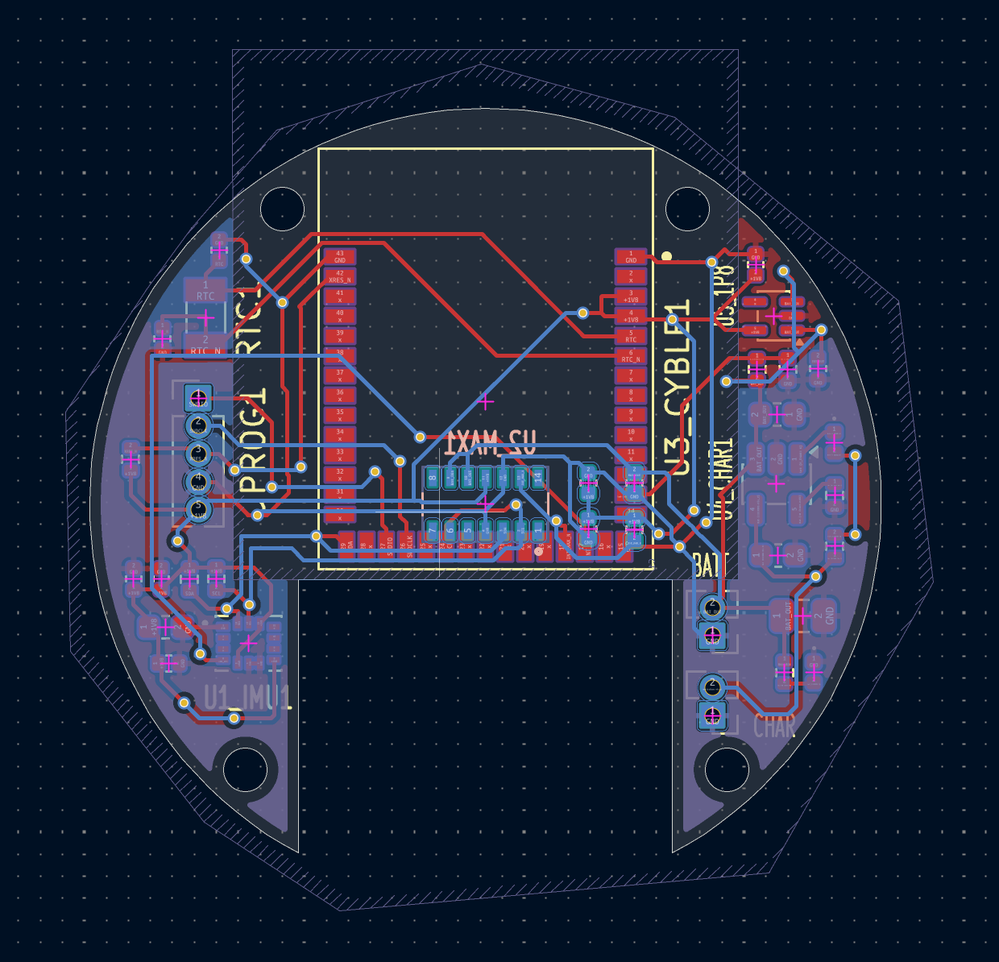

---

## Assembled hardware

**Bring-up ("proof of life").** The fully populated board running off a LiPo cell on the bench
with the green status LED lit. This was the first power-on test, confirming the CYBLE module,
LDO, and charger all came up correctly before any firmware was flashed.

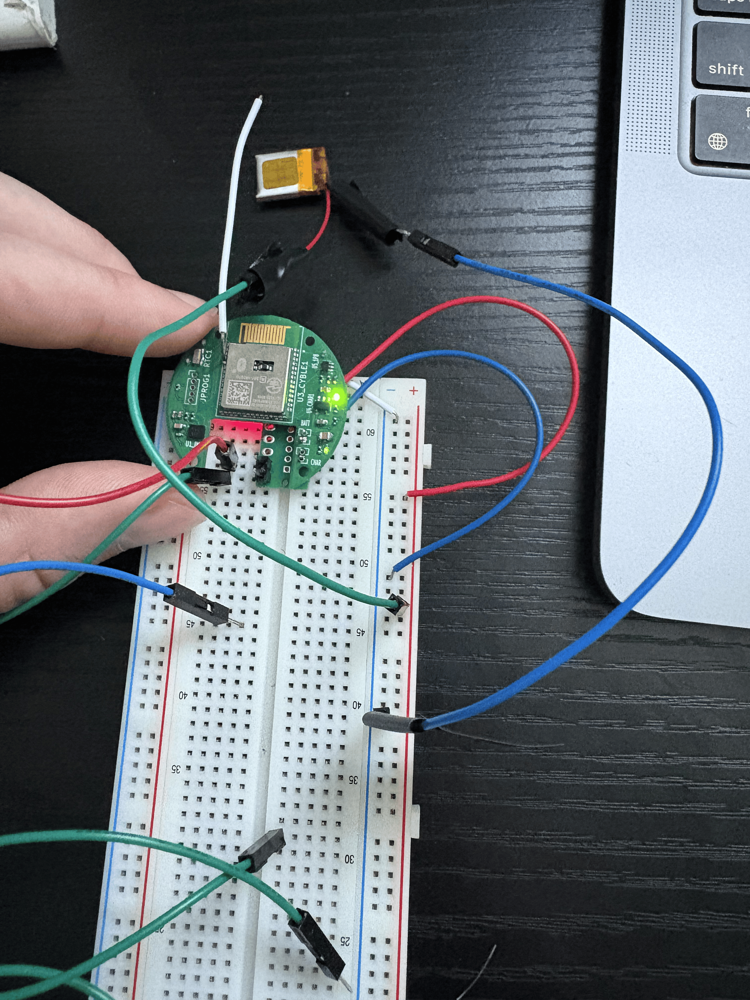

**Size in hand.** The bare board for scale, with the battery leads attached.

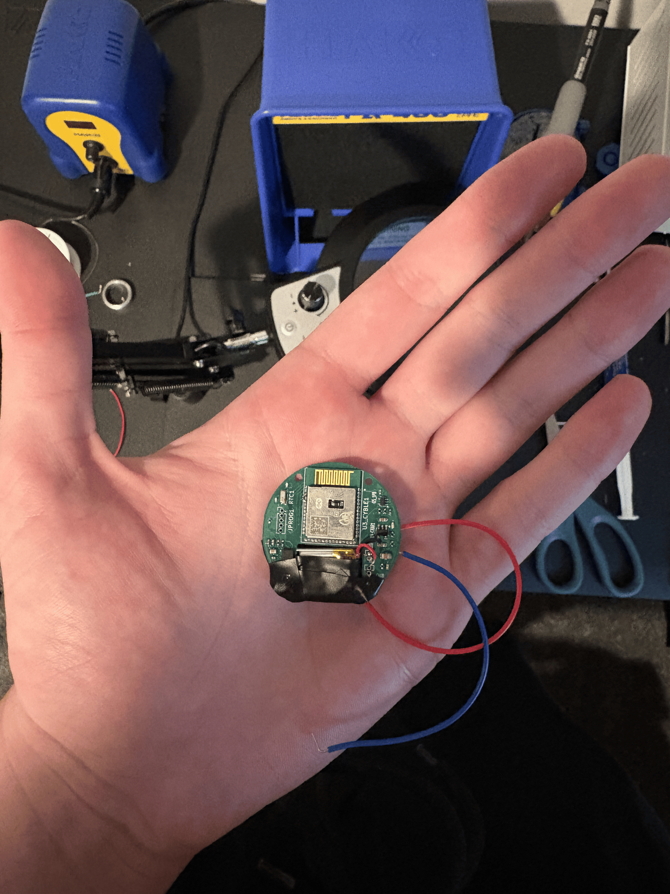

**Assembled front.** The CYBLE-416045-02 and its gold MIFA antenna at the top, the BMI270 IMU
(U1_IMU1) and RTC crystal (RTC1) on the left, the SWD header (JPROG1) on the far left, and the
1.8 V LDO (U5_1P8) plus battery (BATT) and charger (CHAR) pads down the right side.

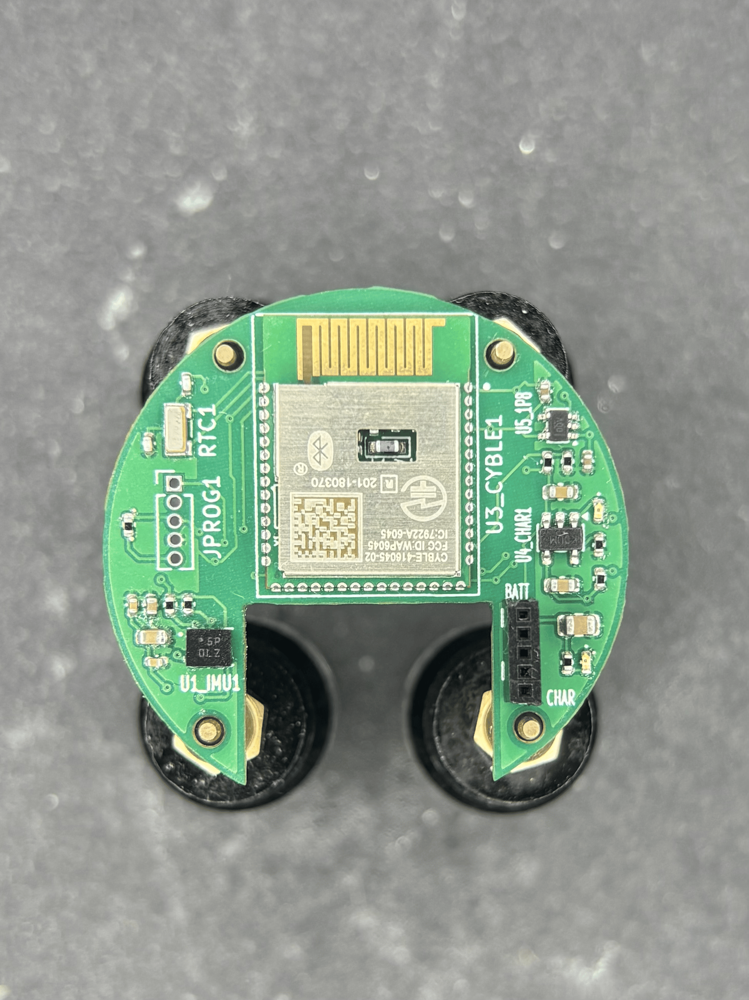

**Assembled back.** The skin-facing side, dominated by the MAX30102 optical HR/SpO2 sensor
(U2_MAX1) in the center, its window sitting flush against the wrist.

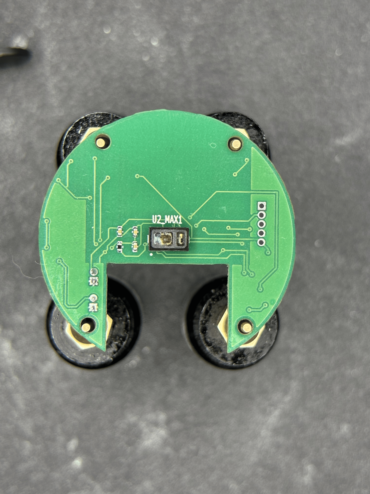

---

## Firmware

Built with **Infineon ModusToolbox** against the **CY8CPROTO-063-BLE** BSP (the same PSoC 6 BLE
part inside the CYBLE-416045-02 module), running **FreeRTOS**. Application code runs on the
Cortex-M4; the Cortex-M0+ runs the BLESS Bluetooth link-layer controller.

```
main.c
  └─ system_control_initialize()
       ├─ I2C init (SCB3, P6_4 SCL / P6_5 SDA, 400 kHz)
       ├─ i2c_mutex (recursive, shared by all sensor tasks)
       ├─ task_max30102        PPG FIFO → health_algo
       ├─ task_bmi270          6-axis IMU + hardware step counter
       ├─ task_sw_steps        software pedometer (SW_STEP_COUNTER builds only)
       ├─ task_system_control  prints health metrics every 2 s
       └─ task_ble             WICED BT stack + GATT notifications every 2 s
```

Both sensors share one 400 kHz I2C bus (MAX30102 at `0x57`, BMI270 at `0x68`), arbitrated by a
recursive mutex. Results land in `health_hr`, `health_spo2`, `health_steps`, and
`health_battery`, which the reporting and BLE tasks consume.

The parts I am most pleased with:

- **The signal processing runs on the device, not the phone.** `health_algo.c` does DC removal
  and moving-average smoothing, then finds heart rate by autocorrelation, looking for the
  strongest self-similarity lag in the 40 to 200 bpm band, with a threshold peak detector as a
  cross-check. A perfusion-index quality gate means a motion-corrupted window holds the last
  good value instead of confidently reporting garbage. SpO2 comes from the Red/IR ratio-of-ratios.
- **Power management is gated on the phone connection.** In `LOW_POWER` builds the optical
  sensor is fully shut down whenever no phone is connected, and runs live only while the app is
  connected, since HR and SpO2 only matter when someone is looking at them. Steps keep counting
  either way. With gyro-off, adaptive LED drive, shorter LED pulses, and slow BLE advertising and
  connection parameters, measured draw goes from about 12 mA to about 9 mA.
- **The step counter diagnoses itself.** The BMI270 needs an 8 KB configuration blob loaded over
  I2C at boot, which is by far the most demanding transfer on the bus, so the loader retries with
  a soft reset up to five times rather than bricking the task on a bad load. One of my boards
  appeared to have a dead feature engine, so I wrote a pure-software accelerometer pedometer
  (`SW_STEP_COUNTER`) as a drop-in replacement. The root cause turned out to be a cold solder
  joint, and re-reflowing the part fixed it, but the fallback stayed in.

Full detail, including the low-power measurements and the complete BMI270 debugging trail, is in
[`software/README.md`](software/README.md).

### BLE services

| Service | Characteristics |
|---------|-----------------|
| OpenBand Health (custom 128-bit) | SpO2 (read + notify), StepCount (read + notify, uint32 LE) |
| Heart Rate (`0x180D`) | HR Measurement (`0x2A37`) |
| Battery (`0x180F`) | Battery Level (`0x2A19`) |

Custom UUIDs: service `5E021176-5E66-483F-AE53-D3291D2CC787`, SpO2
`F1F72B4B-1D76-43A3-ADB2-0E04905ACC8F`, StepCount `C36072C1-2706-41F1-8D28-E0619FE31FFA`.

Heart rate and battery use the standard SIG-assigned services, so the device also works with any
generic BLE tool (nRF Connect shows it as `OpenBand2`) if you would rather not build the app.

---

## iOS app

A native **SwiftUI + CoreBluetooth** dashboard that auto-scans, connects, and streams live heart
rate, SpO2, steps, and battery, with a heart-rate trend line. It needs Xcode 16+ and a real
iPhone on iOS 17+, since BLE does not work in the Simulator. A free Apple ID is enough for 7-day
signing.

<p align="center">
  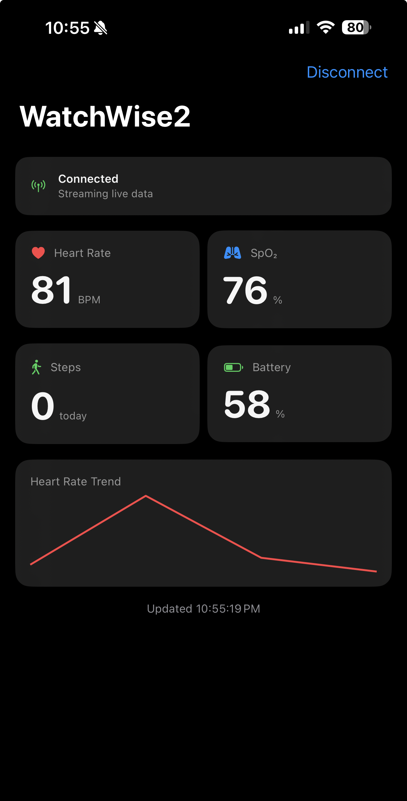
</p>

One detail worth mentioning: the firmware reports a *cumulative* step count that resets to zero
whenever the device reboots, so "today's steps" cannot just be the raw value. `StepTracker.swift`
tracks the counter's baseline and handles the reset case.

Build and signing steps are in
[`software/mobile/OpenBandApp/README.md`](software/mobile/OpenBandApp/README.md).

---

## Repository structure

```text
OpenBand/
├── pcb/                             # Board design
│   ├── altium_project/              # Altium project, schematic sheets, 3D
│   ├── watchwise_main_kicad/        # KiCad schematic + layout, JLCPCB outputs
│   └── assembly.txt                 # Assembly notes
│
├── software/
│   ├── README.md                    # Full firmware documentation
│   ├── firmware/                    # ModusToolbox firmware project
│   │   ├── Makefile                 # Build system, programming reset-pulse override
│   │   ├── bsps/                    # CY8CPROTO-063-BLE BSP + BT Configurator output
│   │   └── app/FreeRTOS/tasks/src/
│   │       ├── task_system_control.c    # I2C/UART init, task spawning, reporting
│   │       ├── task_max30102.c          # PPG driver + power scheduling
│   │       ├── task_bmi270.c            # IMU driver + hardware step counter
│   │       ├── sw_step_counter.c        # Software pedometer fallback
│   │       ├── task_ble.c               # WICED BT stack, GATT, notifications
│   │       ├── health_algo.c            # HR / SpO2 signal processing
│   │       └── ww_rtc.c                 # RTC
│   ├── mobile/OpenBandApp/         # SwiftUI + CoreBluetooth iOS app
│   └── BMI270_debug.txt             # Step-counter investigation log
│
├── case/                            # OpenSCAD sources, STL, 3MF for the enclosure
├── devices/                         # Datasheets and reference material
│   ├── SoC/                         # CYBLE / PSoC 6 reference
│   ├── peripheral/                  # MAX30102, BMI270, MCP73831, LDO, battery
│   └── antenna/                     # Chip-antenna design guide
│
├── images/                          # Renders and photos used in this README
├── receipts/                        # DigiKey and JLCPCB orders
├── OpenBand-BOM.csv                # Bill of materials with DigiKey part numbers
└── interactive_BOM.html             # Clickable board view with component highlighting
```

---

## Bill of materials

Total BOM cost: **~$131.52** for a qty-3 order, so roughly **$44 per unit** in parts.

Open [`interactive_BOM.html`](interactive_BOM.html) in a browser for a clickable board view that
highlights each component in place. The full part list with DigiKey numbers is in
[`OpenBand-BOM.csv`](OpenBand-BOM.csv).

### ICs & modules

| Designator | Part | Description | DigiKey P/N |
|------------|------|-------------|-------------|
| U3_CYBLE1 | CYBLE-416045-02 | PSoC6 BLE module with integrated antenna (SMD) | 448-CYBLE-416045-02CT-ND |
| U2_MAX1 | MAX30102EFD+T | Optical heart rate and SpO2 sensor (I2C) | MAX30102EFD+TCT-ND |
| U1_IMU1 | BMI270 | 6-axis IMU, accelerometer and gyroscope (I2C/SPI) | 828-1091-1-ND |
| U4_CHAR1 | MCP73831T-2ACI/OT | Single-cell LiPo battery charger IC (SOT-23-5) | MCP73831T-2ACI/OTCT-ND |
| U5_1P8 | TLV70018DCKR | 1.8V LDO regulator, 200mA (SC-70-5) | 296-32409-1-ND |

### Indicators

| Designator | Part | Description | DigiKey P/N |
|------------|------|-------------|-------------|
| P_BATT1 | LTST-C281KGKT | Green LED, battery status indicator (0402) | 160-LTST-C281KGKTCT-ND |
| P_CHAR1 | VLMG1500-GS08 | Yellow-green LED, charge status indicator (0402) | VLMG1500-GS08CT-ND |

### Crystal

| Designator | Part | Description | DigiKey P/N |
|------------|------|-------------|-------------|
| RTC1 | MU00525-32.768K | 32.768 kHz crystal, 6pF load, SMD 3.2×1.5mm | 644-MU00525-32.768KCT-ND |

### Resistors

| Designator | Value | Description | DigiKey P/N |
|------------|-------|-------------|-------------|
| R1, R2, R3 | 4.7kΩ | I2C pull-ups (0402) | 311-4.7KJRCT-ND |
| R4, R_PWR1 | 10kΩ | General pull-up/down resistors (0402) | 311-10KJRCT-ND |
| RLED1 | 470Ω | LED current-limiting resistor (0402) | 311-470LRCT-ND |
| R_PROG1 | 47kΩ | MCP73831 charge-current programming resistor, sets ~21mA charge rate (0402) | 311-47.0KLRCT-ND |
| RD1 | 100kΩ | Battery voltage divider, lower leg (0402) | 311-100KLRCT-ND |
| RD2 | 220kΩ | Battery voltage divider, upper leg (0402) | 311-220KLRCT-ND |

> RD1 + RD2 form a resistor divider for ADC-based battery level sensing. R_PROG1 programs the
> MCP73831 charge current: I_CHG = 1000V / R_PROG(kΩ) ≈ 21mA.

### Capacitors

| Designator | Value | Package | Notes | DigiKey P/N |
|------------|-------|---------|-------|-------------|
| C1, C2, C4, C6, C10 | 0.1µF | 0402 | Bypass caps | 1276-1002-1-ND |
| C11, C12 | 1µF | 0402 | Bypass/decoupling | 399-C0402C105K9PACTUCT-ND |
| C3 | 4.7µF | 0402 | Decoupling, low-voltage rail | 1276-1482-1-ND |
| C13, C14 | 4.7µF | 0603 | Decoupling, BAT_OUT rail (3.7–4.2V); 0603 required to avoid derating | 1276-1044-1-ND |
| C9 | 10µF | 0603 | Bulk decoupling | 1292-0603X106M100CT-ND |
| C5 | 10µF | 0805 | Bulk decoupling, BAT_OUT rail (3.7–4.2V); 0805 required to avoid derating | 1276-1096-1-ND |
| C7, C8 | 6pF | 0402 | RTC crystal load capacitors | 490-3104-1-ND |

> C5, C13, and C14 are sized at 0805/0603 rather than 0402 because ceramic capacitance drops
> significantly under DC bias. Since BAT_OUT runs at 3.7 to 4.2 V, the larger packages are needed
> to hold rated capacitance.

---

## Build one

**Boards.** KiCad sources and JLCPCB fabrication outputs are in
[`pcb/watchwise_main_kicad/`](pcb/watchwise_main_kicad); the Altium project is in
[`pcb/altium_project/`](pcb/altium_project). Order parts from
[`OpenBand-BOM.csv`](OpenBand-BOM.csv).

> The PCB files still carry the project's original name, WatchWise. The gerbers are the exact
> set the fabricated boards were built from, so they are left untouched as a record of what was
> actually manufactured.

**Enclosure.** Print `openband_case_V2.stl` and `openband_case_strap.stl` from
[`case/`](case). You will need four M1.6 x 4 mm screws and a standard strap.

**Firmware.** From `software/firmware/`:

```bash
make getlibs      # First time only: pull .mtb dependencies
make build
make program      # Flash via KitProg3 over the JPROG1 SWD header
```

Optional build flags, composable and off by default:

```bash
make program DEFINES=LOW_POWER                      # Sensor gating, gyro off, slow BLE
make program DEFINES=SW_STEP_COUNTER                # Software pedometer fallback
make program DEFINES="LOW_POWER SW_STEP_COUNTER"    # Both
```

Debug output is on UART P5_0/P5_1 at 115200 baud over the KitProg3 USB COM port.

> If `make program` fails with `acquire_psoc request failed`, press the JPROG1 pins in firmly and
> retry. JPROG1 has an RC filter on `XRES_N`, so the Makefile already widens the reset pulse; the
> BLE firmware sleeps the chip, so the reset has to catch it.

**Connect.** Open the iOS app, or scan with nRF Connect for `OpenBand2` and subscribe to the
SpO2 and StepCount notifications.

---

## Status and what is left

The prototype works end to end. Heart rate, SpO2, steps, and battery all read correctly and
stream live to the phone. What it is not yet is a device you would wear for a week without
thinking about it:

- **Battery life is the honest weak point.** About 5 hours on the 60 mAh cell in the default
  build, about 6.7 hours with `LOW_POWER`. The ceiling is the always-awake MCU, which is roughly
  78% of the ~12 mA baseline draw. Every other optimization is rearranging the remaining 22%.
- **Tickless deep sleep is the actual fix** and is not implemented yet. `Cy_SysPm_DeepSleep` plus
  FreeRTOS tickless idle should take idle draw from milliamps to microamps, projecting to roughly
  20 hours, and it is also what lets the BLE controller sleep between connection events. It needs
  careful handling of in-flight I2C, UART, and BLE transactions, so it is real work rather than a
  flag flip.
- **Off-wrist sleep** would push standby to days by using the IMU to notice the device is not
  being worn.
- **On-demand measurement over BLE.** Right now the phone connection itself is the trigger. A
  writable characteristic that requests a single measurement needs a GATT database change in BT
  Configurator.
- **No water resistance.** The enclosure is a printed shell with no gasket.

---

## License

Software and hardware are licensed separately, because copyright treats source code and design
files differently.

| What | License | Covers |
|------|---------|--------|
| **Software** | [MIT](LICENSE) | Firmware in `software/firmware/app/`, the iOS app in `software/mobile/` |
| **Hardware** | [CC BY 4.0](LICENSE-HARDWARE) | KiCad design in `pcb/watchwise_main_kicad/`, enclosure in `case/`, the BOM |

Both are permissive. Build one, modify it, sell it if you want. Just keep the attribution.

These licenses cover my original work only. This repo also contains third-party material that
stays under its own terms: the Infineon ModusToolbox BSP and Bluetooth stack, the FreeRTOS
kernel, Bosch's BMI270 configuration blob, and some UW-Madison ECE 453 course scaffolding. The
[NOTICE](NOTICE) file lists exactly what belongs to whom. Check it before redistributing,
since the Infineon terms in particular are more restrictive than MIT.

> **Not a medical device.** This is a personal prototype with no regulatory clearance. The heart
> rate and SpO2 numbers are not clinically validated and should not inform any health decision.
